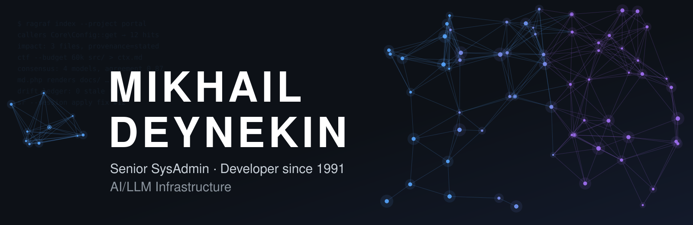
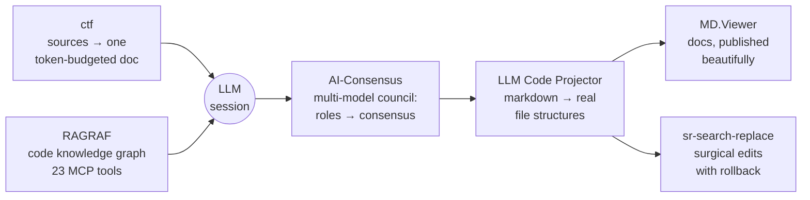
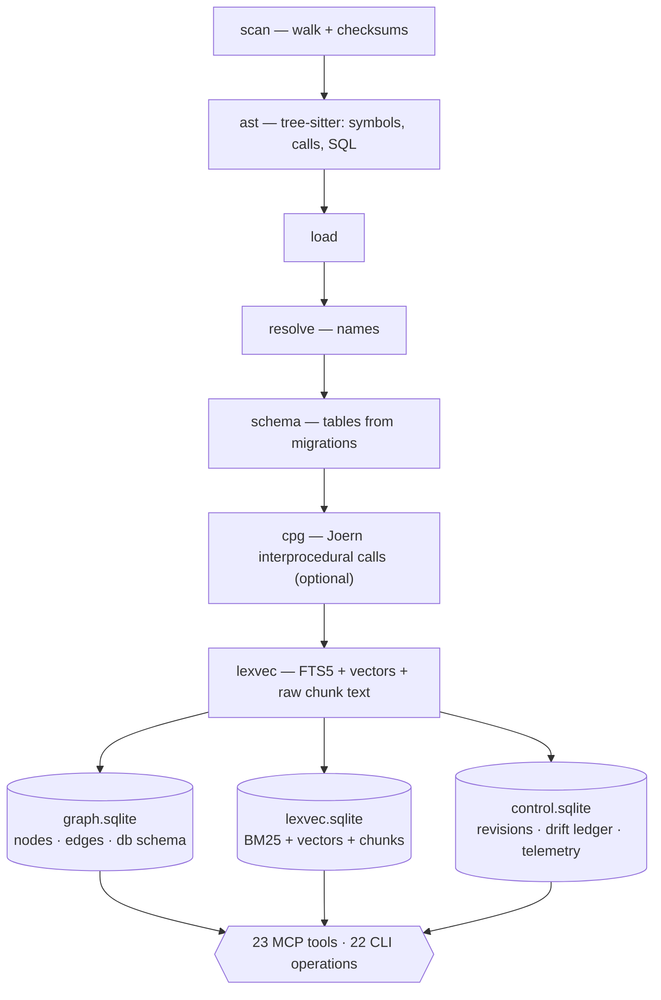
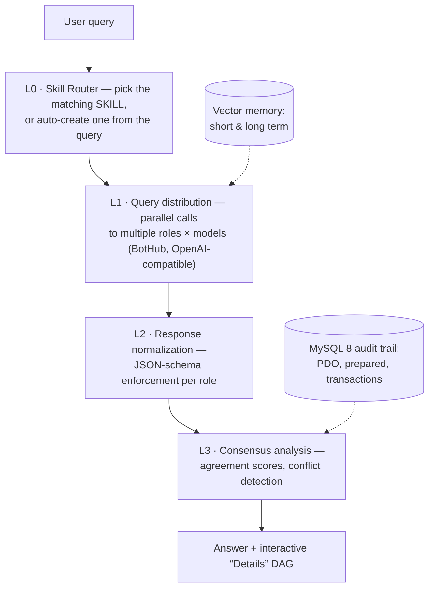
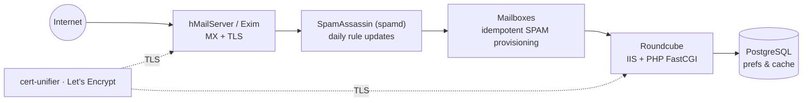
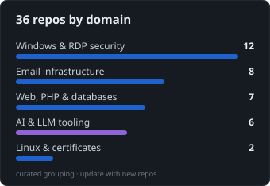

<!--
  ────────────────────────────────────────────────────────────────────────────
  PROFILE README · Mikhail Deynekin (@paulmann) · rev.3 · 2026-10
  Design language: dark GitHub palette (#0d1117 / #161b22 / #58a6ff / #a371f7),
  motion where it earns its place (animated SVG banner & wave divider, typing
  lines, capsule waves), live shields badges for repo vitals, native mermaid
  diagrams, self-hosted SVG cards for unique content.
  MAINTENANCE (quarterly):
    1. Re-run build_svg_assets.py from the delivery package → refreshes local SVG
    2. Run qa/link_check.py from the delivery package → every URL must stay 200
    3. markdownlint this file (config: delivery package qa/.markdownlint.json)
    4. Update release versions in toolchain tables; refresh «Currently».
  Badge logos: simple-icons (CC0-1.0). Live badges: shields.io.
  ────────────────────────────────────────────────────────────────────────────
-->

<div align="center">



[](https://git.io/typing-svg)


</div>

<details>
<summary>🧭 Contents — the page is long on purpose; jump straight to what you need</summary>

<br/>

1. [About me](#-about-me)
2. [Operating principles](#-operating-principles)
3. [Expertise matrix](#-expertise-matrix)
4. [AI & LLM engineering](#-ai--llm-engineering) — RAGRAF · AI-Consensus · ctf · LLM Code Projector · MD.Viewer · sr-search-replace · MCP reference
5. [Infrastructure engineering](#-infrastructure-engineering) — Windows & RDP · email · web/PHP · Linux
6. [Tech stack](#-tech-stack)
7. [Live metrics](#-live-metrics)
8. [Quality bar](#-quality-bar)
9. [Documentation & reference](#-documentation--reference)
10. **Repository navigator** (collapsed catalogue below)
11. [Collaboration](#-collaboration) · [Connect](#-connect)

</details>

---


### 👋 About me

I am **Mikhail Deynekin** — a senior sysadmin and developer based in **Frankfurt am Main,
Germany**, in IT continuously **since 1991**: from DOS workstations and BBS boards to
Kubernetes-era infrastructure and, today, **LLM agent tooling**. I build the kind of
software I want to operate at 3 a.m.: idempotent, self-documenting, honest about its
failures, and measurable.

- 🔧 **35+ years** across Windows & Linux infrastructure: automation, hardening, forensics
- 🤖 **Current focus:** code knowledge graphs for agents ([RAGRAF](https://github.com/paulmann/RAGRAF)), MCP contracts, multi-model consensus ([AI-Consensus](https://github.com/paulmann/AI-Consensus))
- 📧 **Email infrastructure** specialist: hMailServer, Exim, Roundcube, SpamAssassin, SPF/DKIM/DMARC
- 🖥️ **RDP security toolkit** author and the [Windows 11 25H2 enablement script](https://github.com/paulmann/Windows-11-25H2-Update-Script) used in production fleets
- 🧾 **Docs-as-product:** every serious repo ships architecture notes, agent regimens, options references
- 🌐 [deynekin.com](https://deynekin.com/) · 📬 [Mikhail@Deynekin.com](mailto:Mikhail@Deynekin.com) · 🕐 replies within 24 h

<br clear="right"/>

> [!NOTE]
> **How I work in one sentence:** measure first, automate second, document always —
> and never let a tool guess silently when it could say *“I don’t know, here is why.”*

---

## 🧭 Operating principles

| # | Principle | What it looks like in code |
|:---:|---|---|
| 1 | **Verifiable facts over plausible text** | [RAGRAF](https://github.com/paulmann/RAGRAF) answers only with `file:line` proofs and `provenance: stated/derived`; benchmarks live in `bench/results/`, not in marketing |
| 2 | **Honest degradation, never silent failure** | No Joern layer → `capability=degraded` and a plain refusal from `slice`; [Clear-TempFolders](https://github.com/paulmann/Clear-TempFolders) ships a DryRun mode; [ctf](https://github.com/paulmann/ctf-collect-to-file) never executes what it reads |
| 3 | **Idempotence by default** | [hMailServer-Spam-Provisioner](https://github.com/paulmann/hMailServer-Spam-Provisioner) is safe to re-run on every boot; ctf snapshots are reproducible with per-file hashes |
| 4 | **Zero-dependency core, optional power layers** | ctf = one POSIX script; RAGRAF embeddings run **without torch**, Joern is optional; [MD.Viewer](https://github.com/paulmann/MD.Viewer) needs no build, DB, or framework |
| 5 | **Documentation is the product** | Six-part council design in AI-Consensus, an agent integration regimen in RAGRAF, token-budget guides in ctf — and this profile |

---

## 🎯 Expertise matrix

| Domain | Depth | Evidence in this profile | Core tech |
|---|---|---|---|
| **AI & LLM engineering** | Building agent tooling: RAG, MCP servers, multi-model consensus, context pipelines | RAGRAF · AI-Consensus · ctf · LLM Code Projector | Python 3.13, PHP 8.4, SQLite (graph+FTS5+vectors), tree-sitter, MCP |
| **Email infrastructure** | Production mail since the pre-cloud era: MX, filtering, deliverability, webmail | 8 repos under *Email infrastructure* | hMailServer, Exim, SpamAssassin, Roundcube, SPF/DKIM/DMARC |
| **Windows & RDP security** | Fleet automation, session forensics, upgrade engineering, security-log analysis | 12 repos under *Windows & RDP security* | PowerShell 5.1–7.6, C#, Windows Security log, BITS, GPO-level hygiene |
| **Web & PHP backend** | Single-file engines, IIS + FastCGI deployments, WordPress/WooCommerce ops | HTML.PHP · MD.Viewer · IIS-PHP-FastCGI-AutoDeploy | PHP 8.3+, IIS, WordPress, WooCommerce |
| **Databases** | PostgreSQL/MySQL operations: encoding migrations, cache truncation, tuning & replication | pg-encoding-migrator · Clean-RoundCube-Cache-PostgreSQL-Windows | PostgreSQL, MySQL/MariaDB, PDO with prepared statements |
| **Linux & network ops** | RouterOS filtering, certificate hygiene, disk/power management, cron discipline | sata-spindown-guard · cert-unifier · Bash_WP-CLI_Update | Bash, RouterOS, hdparm, Let’s Encrypt |

---

## 🤖 AI & LLM engineering

Not a pile of experiments — a **connected toolchain**. Each tool closes one gap of the
agent-assisted development loop, and every gap I hit in my own work became a repo:



### 🧠 RAGRAF — a graph-and-vector knowledge base of code for LLM agents

> Answers *“where is it, who calls it, what breaks if I change it, how is it done
> elsewhere”* with **verifiable `file:line` facts** — instead of blind `rg` and
> full-file reads. One SQLite per corpus holds the graph, the BM25 lexicon, the
> vectors and the drift ledger.

<p>
  
  
  
  
  
</p>

**Indexing pipeline & stores**



**Measured, not promised** — real PHP portal, 14 navigation tasks, artifacts in `bench/results/`:

| Metric | Without the index | With RAGRAF |
|---|:---:|:---:|
| Tool calls for 14 tasks | 28 (modelled realistically 43) | **14** |
| Average calls per task | 2.0 / 3.1 | **1.0** |
| Candidates to review | up to 34 files | 1–5 exact |
| Files read in full | 14 (minimum) | **0** |
| Target-file hit on the first query | — | **92 %** (12/13) |
| Verifiability (facts with `file:line`) | — | **100 %** |

**Three design decisions, each born from a measured defect**

1. **Immutable index + drift ledger** instead of “update on the fly”. Inside a revision the index never changes; code edits accumulate in the ledger and affected facts turn `stale`. Mixing timestamps inside one answer is exactly how wrong conclusions are born.
2. **No free-form graph query language for the agent.** Fixed operations only: in LLMxCPG (USENIX Security ’25) base models produced 132/1278 and 19/1278 valid CPGQL queries versus 1278/1278 for a fine-tuned one — a query language turns base models into error generators.
3. **Every fact carries proof:** `path:line`, `provenance` (`stated` / `derived`), `index_rev`, `confidence`. An edge without evidence looks credible only because it came “from the database”.

<details>
<summary>🔌 MCP tool reference — the full <code>ragraf_*</code> contract (23 tools)</summary>

<br/>

| Tool | Answers |
|---|---|
| `ensure` | bootstrap: corpus is indexed and current before the session starts |
| `index_status` | revision, parse completeness, degradation, ledger size |
| `drift_report` | ledger of divergences between index and code |
| `drift_ack` | acknowledge ledger entries after review |
| `search` | “where is this written about” — hybrid BM25 + vector; `--with-text` returns snippets from the index |
| `symbol` | definition site: kind, file, lines, signature |
| `references` | where else the symbol is used |
| `callers` | who calls it |
| `callees` | what it calls |
| `impact` | what a change affects — proven and heuristic links reported separately; mandatory before edits |
| `slice` | structural slice (nodes, edges, lines) without function bodies — full capability only |
| `code` | symbol bodies; text from the index by default, `text_source: index|disk` in every span |
| `repo_map` | repository map within a character budget; `chars_used` is measured, not estimated |
| `schema` | what is in a DB table (from migrations) |
| `table_usage` | who reads or writes the table |
| `routes` | routes and entry points |
| `live_read` | the current file on disk with differences from the index highlighted |
| `policy_trace` | who gets a permission, and under which condition |
| `class_usage` | a styling class: where defined, where applied, what diverges |
| `write_check` | is this write valid — write plan checked against the schema before running |
| `usage` | call telemetry and effect estimation |
| `freshness` | is the index current (checksum comparison) |
| `catalog` | corpus registry: what is indexed, with which checksums |

*There is, and will be, no free-form graph query tool (FT-15): a `MATCH … RETURN`
attempt is rejected with code `-32602`.*

</details>

**Quick start**

```bash
ragraf init <project-dir>                       # creates config/myproject.yaml
python tools/ragraf.py --project config/myproject.yaml index
```

```json
{
  "mcpServers": {
    "ragraf": {
      "command": "python",
      "args": ["<repo>/tools/ragraf-mcp.py", "--project", "<repo>/config/myproject.yaml"]
    }
  }
}
```

> [!IMPORTANT]
> **Degradation is a feature.** No Joern layer → `capability=degraded` and an honest
> refusal from `slice`; no embedding model → lexical search still works; no free port →
> the server says why. *Silent degradation never happens.*

### 🏛️ AI-Consensus — an OpenCorum-style council of LLMs

A PHP 8.4 web application where **several models deliberate in defined roles**, a
consensus engine scores their agreement, and every answer ships a clickable DAG of the
whole session. Full audit trail: every model response, every step, every score — in MySQL.

<p>
  
  
  
</p>



- **SKILLS system** — declarative JSON workflows defining agent roles, prompts and consensus rules; the router auto-selects or auto-creates the most relevant SKILL per query.
- **Strict PHP 8.4** — strict types, readonly properties, enums throughout; six-part design doc from architecture to the full CouncilEngine module.

> [!TIP]
> The council pattern shines where single-model answers are expensive to trust:
> research synthesis, policy-style questions, architecture reviews.

### ctf — collect-to-file: context assembly with a token budget

One self-contained POSIX script (bash 4.2+, shellcheck-clean) that folds a source tree
into **a single Markdown / JSON / JSONL / text document** with relative paths — the
document an LLM reasons over best, or a reviewer reads in one pass.

<p>
  
  
  
</p>

```bash
ctf --budget 60000 src/ > context.md        # LLM context, capped at a token budget
ctf --format jsonl --hashes . > audit.jsonl  # auditable snapshot, per-file hashes
```

| Format | Best for |
|---|---|
| Markdown | LLM context & cross-file review: syntax-highlighted, path-annotated |
| JSON / JSONL | machine pipelines, chunkers, RAG ingest |
| Text | diffs, greps, plain archives |

It does not shell out to `eval`, does not execute anything it reads, never writes
outside the file you asked for.

### 🏗️ LLM Code Projector — markdown answers → real file structures

The reverse direction of the loop: feed it a ChatGPT/Claude/DeepSeek/Gemini answer with
project trees and code fences — get a **runnable directory tree** in one command.
Recognizes ASCII and Unicode trees, any nesting depth.

```bash
./MD_to_Files.sh chatgpt_response.md ./my-new-project
```

<p>
  
  
</p>

### 📚 MD.Viewer — zero-build documentation publishing

The loop’s last mile: LLM- and human-written markdown rendered as polished docs.
Auto TOC with heading numbering, Mermaid with auto-repair, glossary tooltips, dark mode,
code-copy controls, searchable file browser, built-in self-updater — **no build step,
no database, no framework**: copy `md.php` next to your `.md` files and open it.

<p>
  
  
  
</p>

### 🔧 sr-search-replace — the “apply the fix” step

Universal search & replace with **session rollback**, binary detection and backup
management: the safe way to let an agent (or yourself) touch forty files at once.

<p>
  
  
</p>

> [!WARNING]
> **Agent regimen I actually follow** (from RAGRAF’s integration doc): start with
> `index_status` + `drift_report`; never base a conclusion on a fact marked `stale` —
> `live_read` it first; whole-file reads are the last resort, not the first reflex.

---

## 🏭 Infrastructure engineering

The other half of my life: systems that must stay up, stay secure, and stay boring.

### 🪟 Windows & RDP security

| Project | Role |
|---|---|
| [Windows-11-25H2-Update-Script](https://github.com/paulmann/Windows-11-25H2-Update-Script) | 24H2 → 25H2 via official enablement package KB5054156: BITS fallback, retry logic, signature validation, full logging |
| [RDP-Diagnostic-Tool](https://github.com/paulmann/RDP-Diagnostic-Tool) | Complete RDP readiness diagnostics with auto-remediation & reporting |
| [1st-Remote-Session-Manager-Pro](https://github.com/paulmann/1st-Remote-Session-Manager-Pro) | Shadow, view-only, disconnect, message, logoff — with GitHub auto-updates |
| [RDPAudit](https://github.com/paulmann/RDPAudit) | Real-time security monitoring & session auditing (C#) |
| [1st-RDPMon](https://github.com/paulmann/1st-RDPMon) | Server-side session monitoring & alerting |
| [Get-Windows-Security-Events-By-IP](https://github.com/paulmann/Get-Windows-Security-Events-By-IP) | Forensic Security-log analysis by IPv4/IPv6 with failure-code decoding |

```powershell
.\Upgrade-Win11-To-25H2.ps1 -RetryCount 5    # enterprise guardrails baked in
```

### 📬 Email infrastructure — the full delivery chain



- **hMailServer** at the core: domains, accounts, aliases, lists, CSV/JSON export, antivirus integration (Defender, Kaspersky, ClamAV)
- **SpamAssassin as a Windows service** under PowerShell 7 with Task-Scheduler rule updates
- **Deliverability stack:** SPF · DKIM · DMARC configured and monitored, not “set and forgotten”
- **Roundcube ops:** deployment on IIS + FastCGI, PostgreSQL backend, cache truncation tooling

> [!TIP]
> Mail troubleshooting order I trust: DNS & rDNS → SPF/DKIM/DMARC alignment → spam-score
> breakdown → content rules. Nine times out of ten the problem is the first two.

### 🌐 Web, PHP & databases

- [HTML.PHP](https://github.com/paulmann/HTML.PHP) — single-file PHP 8.3+ template engine: Apache SSI directives, `html4.pl`-compatible API, XSS-safe by default
- [IIS-PHP-FastCGI-AutoDeploy](https://github.com/paulmann/IIS-PHP-FastCGI-AutoDeploy) — one-shot IIS + PHP FastCGI installer (Roundcube-ready)
- [pg-encoding-migrator](https://github.com/paulmann/pg-encoding-migrator) — safe PostgreSQL encoding migration (e.g. WIN1251 → UTF-8)
- [woocommerce-1c-data-cleaner](https://github.com/paulmann/woocommerce-1c-data-cleaner) · [Bash_WP-CLI_Update](https://github.com/paulmann/Bash_WP-CLI_Update) · [Clean_BOM_Senior](https://github.com/paulmann/Clean_BOM_Senior) · [BAS-IP](https://github.com/paulmann/BAS-IP)

### 🐧 Linux & network ops

- [sata-spindown-guard](https://github.com/paulmann/sata-spindown-guard) — cron-based HDD spindown guard (`hdparm`), safe for unmounted drives
- [cert-unifier](https://github.com/paulmann/cert-unifier) — unified PEM (key + chain) for Let’s Encrypt deployments
- RouterOS filtering & monitoring practice; bash tooling with cron discipline and dry-run habits

---

## 🧰 Tech stack

<div align="center">

**Languages & scripting**


**AI & LLM**


**Infrastructure & OS**


**Databases**


**Email & web**


</div>

---

## 📊 Live metrics

<div align="center">




*Stats & language cards are local SVG snapshots rebuilt from the live GitHub API
by `build_svg_assets.py` (delivery package) — immune to third-party rate limits and outages;
streak stays live via streak-stats.*

</div>

---

## 🏅 Quality bar

| Signal | Where to verify |
|---|---|
| **shellcheck-clean** tooling | ctf v4.0.0 README badge & CI-equivalent checks |
| **SemVer discipline** | ctf v4.0.0 · Projector v6.0.1 · MD.Viewer v2.11.3 · AI-Consensus v1.0.0 |
| **100 % MIT** across public repos | LICENSE file in every repository |
| **Self-updating deployments** | MD.Viewer `updater.php` v3.14.0 · RSM-Pro GitHub auto-updates |
| **Measured performance** | RAGRAF `bench/results/` artifacts · ctf Performance section |
| **Security defaults** | signature validation (Win11 script) · XSS-safe escaping (HTML.PHP) · admin checks (Print-Spooler-Queue-Cleanup) · prepared statements (AI-Consensus) |
| **Token-budget awareness** | `ctf --budget` · `ragraf_repo_map` `chars_used` measured volume |

---

## 📚 Documentation & reference

Every serious repo ships its own field guide. The most useful entry points:

| Document | Where | What it teaches |
|---|---|---|
| **Agent integration regimen** | `RAGRAF → docs/implementation/INTEGRATION.md` | Call order, drift discipline, hard rules, MCP config — copy-pasteable into `AGENTS.md` |
| **Capabilities & design decisions** | `RAGRAF → README` | The 22-operation contract, 16 parsed languages, three decisions with their measured defects |
| **Council engine design, parts 1–6** | `AI-Consensus → docs/` | Architecture, SKILL JSON schema, MySQL DDL, controller flow, full PHP 8.4 engine |
| **Options reference & token budgets** | `ctf-collect-to-file → README` | Every flag, four formats, budget fitting, exit codes, Windows notes, performance |
| **Input format & instructions for LLMs** | `LLM Code Projector → README` | How to format LLM answers so they materialize into clean file trees |
| **Zero-build docs deployment** | `MD.Viewer → README` | `md.php` + updater: self-hosted documentation without a toolchain |
| **Enterprise upgrade quickstart** | `Windows-11-25H2-Update-Script → README` | PowerShell & Batch entry points, parameters, logging layout |
| **Idempotent provisioning contract** | `hMailServer-Spam-Provisioner → README` | What re-running changes (nothing) and guarantees (everything) |
| **Service-mode SpamAssassin on Windows** | `SpamAssassin-Windows-PS7 → README` | `spamd` as a system service + daily rule updates via Task Scheduler |

<details>
<summary>🗂️ Repository navigator — all public repos by domain</summary>

<br/>

**AI & LLM**
[RAGRAF](https://github.com/paulmann/RAGRAF) · [AI-Consensus](https://github.com/paulmann/AI-Consensus) · [ctf-collect-to-file](https://github.com/paulmann/ctf-collect-to-file) · [LLM Code Projector](https://github.com/paulmann/1st-Launch-Projects-Code-from-LLM-Responses-in-Markdown-into-Actual-File-Structures) · [MD.Viewer](https://github.com/paulmann/MD.Viewer) · [sr-search-replace](https://github.com/paulmann/sr-search-replace)

**Windows & RDP security**
[Windows-11-25H2-Update-Script](https://github.com/paulmann/Windows-11-25H2-Update-Script) · [RDP-Diagnostic-Tool](https://github.com/paulmann/RDP-Diagnostic-Tool) · [1st-Remote-Session-Manager-Pro](https://github.com/paulmann/1st-Remote-Session-Manager-Pro) · [1st-RDPMon](https://github.com/paulmann/1st-RDPMon) · [RDPAudit](https://github.com/paulmann/RDPAudit) · [Get-Windows-Security-Events-By-IP](https://github.com/paulmann/Get-Windows-Security-Events-By-IP) · [Windows-LogOff](https://github.com/paulmann/Windows-LogOff) · [windows-show-all-tray-icons](https://github.com/paulmann/windows-show-all-tray-icons) · [Windows-Cleaner-and-Optimizer](https://github.com/paulmann/Windows-Cleaner-and-Optimizer) · [Clear-TempFolders](https://github.com/paulmann/Clear-TempFolders) · [Print-Spooler-Queue-Cleanup](https://github.com/paulmann/Print-Spooler-Queue-Cleanup) · [Import-CaCertificates](https://github.com/paulmann/Import-CaCertificates)

**Email infrastructure**
[hMailServer-Spam-Provisioner](https://github.com/paulmann/hMailServer-Spam-Provisioner) · [SpamAssassin-Windows-PS7](https://github.com/paulmann/SpamAssassin-Windows-PS7) · [PowerShell_Export-hMailServerData](https://github.com/paulmann/PowerShell_Export-hMailServerData) · [hMailServer-External-Antivirus](https://github.com/paulmann/hMailServer-External-Antivirus) · [hmailserver-kaspersky-cleanup](https://github.com/paulmann/hmailserver-kaspersky-cleanup) · [hmailserver-clamav-cleanup](https://github.com/paulmann/hmailserver-clamav-cleanup) · [Clean-RoundCube-Cache-PostgreSQL-Windows](https://github.com/paulmann/Clean-RoundCube-Cache-PostgreSQL-Windows) · [Contact-Form-7-Spam-Checker](https://github.com/paulmann/Contact-Form-7-Spam-Checker)

**Web, PHP & databases**
[HTML.PHP](https://github.com/paulmann/HTML.PHP) · [IIS-PHP-FastCGI-AutoDeploy](https://github.com/paulmann/IIS-PHP-FastCGI-AutoDeploy) · [Bash_WP-CLI_Update](https://github.com/paulmann/Bash_WP-CLI_Update) · [woocommerce-1c-data-cleaner](https://github.com/paulmann/woocommerce-1c-data-cleaner) · [BAS-IP](https://github.com/paulmann/BAS-IP) · [Clean_BOM_Senior](https://github.com/paulmann/Clean_BOM_Senior) · [pg-encoding-migrator](https://github.com/paulmann/pg-encoding-migrator)

**Linux & certificates**
[sata-spindown-guard](https://github.com/paulmann/sata-spindown-guard) · [cert-unifier](https://github.com/paulmann/cert-unifier)

</details>

<details>
<summary>📬 Email infrastructure arsenal — extended</summary>

<br/>

- **hMailServer** — domains, accounts, aliases, distribution lists, CSV/JSON export, antivirus integration (Defender, Kaspersky, ClamAV)
- **SpamAssassin on Windows** — `spamd` as a system service under PowerShell 7 with daily rule updates via Task Scheduler
- **Idempotent provisioning** — `[SPAM]` IMAP folders + filter rules for every account, safe to re-run
- **Virus cleanup** — Kaspersky and ClamAV scan-and-quarantine tooling for the hMailServer store
- **Deliverability stack** — SPF · DKIM · DMARC configuration and hygiene
- **Roundcube** — deployment on IIS + PHP FastCGI, PostgreSQL backend, cache truncation tooling
- **Exim** — routing, filtering, delivery tuning on Linux

</details>

<details>
<summary>🖥️ RDP & remote access toolkit — extended</summary>

<br/>

- [RDP-Diagnostic-Tool](https://github.com/paulmann/RDP-Diagnostic-Tool) — full readiness check & auto-remediation
- [1st-RDPMon](https://github.com/paulmann/1st-RDPMon) — real-time server-side session monitoring & alerting
- [1st-Remote-Session-Manager-Pro](https://github.com/paulmann/1st-Remote-Session-Manager-Pro) — shadow, control, disconnect, message, logoff
- [RDPAudit](https://github.com/paulmann/RDPAudit) — security monitoring & session auditing (C#)
- [Get-Windows-Security-Events-By-IP](https://github.com/paulmann/Get-Windows-Security-Events-By-IP) — brute-force & auth-failure forensics
- [Windows-LogOff](https://github.com/paulmann/Windows-LogOff) — forcible logoff with residual-process cleanup

</details>

<details>
<summary>🪟 Windows automation & security — extended</summary>

<br/>

- [Windows-11-25H2-Update-Script](https://github.com/paulmann/Windows-11-25H2-Update-Script) — enablement-package upgrade with BITS fallback & signature validation
- [Windows-Cleaner-and-Optimizer](https://github.com/paulmann/Windows-Cleaner-and-Optimizer) — safe browser/system cache cleanup
- [Clear-TempFolders](https://github.com/paulmann/Clear-TempFolders) — TEMP hygiene with DryRun mode
- [Print-Spooler-Queue-Cleanup](https://github.com/paulmann/Print-Spooler-Queue-Cleanup) — forcible spooler queue clear with admin checks
- [Import-CaCertificates](https://github.com/paulmann/Import-CaCertificates) — CA root/intermediate import into Windows stores
- [windows-show-all-tray-icons](https://github.com/paulmann/windows-show-all-tray-icons) — notification-area registry tweak

</details>

---

## 🤝 Collaboration

**Where I add value fastest:**

- 📧 **Email deliverability rescues** — SPF/DKIM/DMARC alignment, spam-filter tuning, hMailServer/Exim migrations
- 🖥️ **RDP hardening & session operations** for Windows fleets, from diagnostics to forensics
- 🪟 **Windows upgrade/update automation** with enterprise guardrails (signatures, retries, logging)
- 🤖 **LLM agent tooling** — code knowledge bases, MCP contracts, context pipelines, consensus patterns
- 🧾 **Evidence-based codebase audits** — RAGRAF-driven, every finding with `file:line`

Open-source collaboration is welcome on any repo: issues with reproduction steps get
answers, pull requests with tests get merged.

### 🧭 Currently

- 🔭 **Building:** RAGRAF — making code knowledge bases a first-class citizen for LLM agents
- 🌱 **Exploring:** agent-safe MCP contracts, consensus scoring for multi-model councils
- 👯 **Open to:** collaborations on AI tooling · consulting on email & RDP infrastructure
- 📫 **Reach me:** [Mikhail@Deynekin.com](mailto:Mikhail@Deynekin.com) — I reply within 24 hours

---

## 🌐 Connect

<div align="center">

[](https://deynekin.com/)
[](mailto:Mikhail@Deynekin.com)
[](https://github.com/paulmann)

*Infrastructure that survives audits. AI tooling that survives reality.*

</div>


